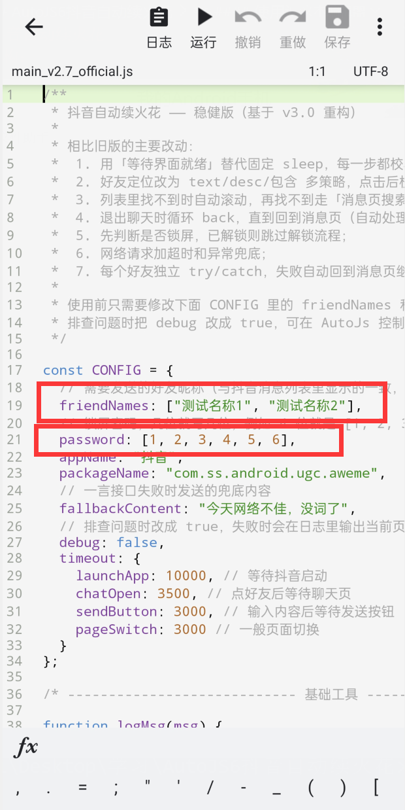
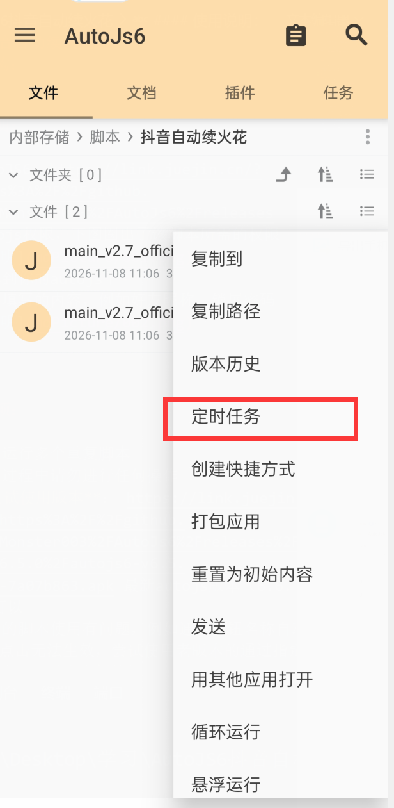

# 抖音自动续火花（AutoJS6）

> **⚠️ 免责声明**
>
> 本项目仅用于 Android 自动化与 AutoJS6 的技术学习和交流。使用脚本自动操作第三方 App 可能违反平台用户协议，存在**账号被限流、功能限制甚至封禁**的风险，请自行评估并承担一切后果。请勿用于商业用途、批量养号或其他违规场景。

一个基于 [AutoJS6](https://github.com/SuperMonster003/AutoJs6) 的抖音自动续火花脚本：定时唤醒手机、解锁、启动抖音、进入消息页，按备注名找到指定好友并发送一条随机「一言」文案，用于维持聊天火花。

为了简化安装，**已将 AutoJS6 v6.8.0 与脚本打包成一个 APK**，安装后即可直接使用，无需再单独安装 AutoJS6，也无需克隆仓库、导入脚本。

- 项目地址：<https://github.com/iewaaa/com.auto.chatflame>
- 一键安装包：[Releases](https://github.com/iewaaa/com.auto.chatflame/releases)
- 安装包文件名：`AutoJs6-v6.8.0-arm64-v8a-带脚本.apk`（约 35 MB，仅支持 **arm64-v8a**）

**使用教程 / 反馈：**

- 作者 B 站主页：[LuckyLK 的个人空间](https://space.bilibili.com/515953193)
- 手把手安装视频：[自研抖音续火花脚本手把手安装教程](https://www.bilibili.com/video/BV1QMGpzbEKV/)

---

## 目录

- [功能特性](#功能特性)
- [版本演进与优化](#版本演进与优化)
- [安装与使用](#安装与使用)
- [配置说明](#配置说明)
- [注意事项（务必阅读）](#注意事项务必阅读)
- [常见问题](#常见问题)
- [项目结构](#项目结构)
- [更新日志](#更新日志)
- [致谢](#致谢)

---

## 功能特性

- **一键安装**：APK 内已集成 AutoJS6 和脚本，省去「装 AutoJS6 + 导入脚本」两步。
- **自动唤醒 / 解锁**：先检测锁屏状态，已解锁则直接跳过；提供两个解锁版本：
  - `main_v2.7_official.js`：锁屏密码版，按密码数组自动点击数字键盘；
  - `main_v2.7_official_nopw.js`：无密码版，只上滑解锁，适配「没有开屏密码、上滑即解锁」的手机。
- **等界面就绪，而不是死等**：所有关键步骤使用 `waitUntil` 轮询目标界面，就绪立即继续，超时才放弃。
- **可靠的页面切换**：点击底部「消息」后校验页面内容，失败自动重试（最多 4 次，交替使用无障碍点击与坐标点击）。
- **多策略找好友**：`text` / `desc` / 包含匹配三种方式，列表里找不到时先滚动查找，再走消息页搜索兜底。
- **防发错人**：点击好友后校验聊天页标题，确认是目标好友才发送；不匹配立即退出，不发送。
- **多好友循环**：`friendNames` 可填任意数量，逐个处理；单个好友失败只跳过该人，不影响后续。
- **随机文案**：调用「一言」接口获取随机句子，失败时发送内置兜底文案。
- **结束收尾**：返回桌面并自动锁屏，同时通过系统通知汇总成功 / 失败名单与耗时。
- **可排查**：`debug: true` 时会在 AutoJS6 控制台输出当前页面节点快照，便于适配新版本抖音。

---

## 版本演进与优化

### 各版本做了什么

| 版本 | 主要变化 | 解决的问题 |
| --- | --- | --- |
| **v1.0**（2025-06） | 最基础的可用版本：上滑后按**固定坐标**点击密码键盘，按昵称直接点击好友，全程固定 `sleep` | 能跑通完整流程，但密码坐标换手机就失效 |
| **v2.0**（2025-07） | 密码改为数组配置，通过控件的 `desc` 文本依次点击数字 | 不再依赖密码键盘的具体坐标，支持任意位数密码 |
| **v3.0**（2025-07） | 增加启动静音、开始 / 结束系统通知、运行耗时统计、更完整的注释 | 使用体验更完整；流程仍是「固定等待 + 单次点击」，稳定性不足 |
| **v2.7 重构版**（2026-11，当前版） | 整体重写：条件等待、页面校验、失败重试、滚动 + 搜索兜底、聊天对象校验、单人失败隔离、双解锁版本、一键 APK | 解决旧版卡死、切页失败、滑过头、点错人、解锁失败等实际问题 |

> 说明：新版按安装包版本号命名为 v2.7，旧版 v3.0 源码保留在 [`老版本/`](老版本/) 目录，方便对照。

### v2.7 量化对比（相对 v3.0）

以下数据来自真机日志实测或按日志推算，不同手机、抖音版本会有差异：

| 指标 | v3.0 旧版 | v2.7 重构版 | 优化幅度 |
| --- | --- | --- | --- |
| 启动抖音 → 消息页 | 固定等待 + 大量 UI 查询，日志中最差出现约 **77 秒**空白等待；点击「消息」前还曾延迟约 **40 秒** | 合并查询 + 条件等待，通常 **10 秒内**进入消息页 | 该阶段耗时下降约 **80%～90%** |
| 首页 UI 查询次数 | 清理弹窗时执行 **12 次**选择器查询，首页单次查询可达约 **6 秒** | 合并为一个正则，仅 **2 次**查询 | 查询次数减少约 **83%**，理论节省约 60 秒 |
| 等待粒度 | 固定 `sleep(1000~5000)`，界面提前就绪也要干等 | `waitUntil(..., 200~500ms)` 轮询，就绪即走 | 最短响应粒度从 1 秒降到约 0.2 秒 |
| 点击「消息」tab | 只点 1 次，失败就卡住，且没有有效日志 | 最多 **4 次**重试，无障碍 / 坐标两种点击方式交替，并校验结果 | 偶发失败可自动恢复，不再无限卡死 |
| 好友定位方式 | 1 种（按名称直接点） | 3 种选择器 + 列表滚动 + 搜索兜底 | 多 **2 条**兜底路径 |
| 误点 / 发错人 | 无任何校验 | 进入聊天后校验标题，不匹配立即退出、不发送 | 校验生效时不发送错误对象 |
| 单个好友失败 | 整个脚本中断，后续好友全部跳过 | 每人独立 `try/catch`，失败后回到消息页继续下一个 | 多好友场景可用性明显提升 |
| 解锁 | 每次都要上滑 + 输密码 | 先检测锁屏；已解锁直接跳过；无密码版只上滑 | 已解锁时节省约 **5～8 秒** |
| 页面判断 | 依赖固定等待 / 底部 tab 是否存在 | 根据页面内容特征判断，tab 存在不代表页面正确 | 切页误判显著减少 |

### 一路踩过的坑

| 坑 | 现象 | 原因 | 处理方式 |
| --- | --- | --- | --- |
| AutoJS6 没有 `device.lockScreen()` | 运行结束报 `TypeError: 无法找到函数 lockScreen` | AutoJS6 与旧版 Auto.js API 不一致 | 改用 `automator.lockScreen()`，并以无障碍全局锁屏动作兜底 |
| AutoJS6 没有 `device.isLocked()` | 明明锁屏却提示「已解锁，跳过解锁」 | 误用了不存在的 API，异常被吞掉 | 改用 Android `KeyguardManager.isKeyguardLocked()` |
| 抖音首页 UI 查询极慢 | 每次 `find()` 可能耗时约 6 秒，启动阶段空白等待长达 77 秒 | 首页节点树庞大，选择器查询开销高 | 弹窗清理从 12 次查询合并为 1 个正则的 2 次查询，并避开 `textMatches(".+")` 全树扫描 |
| 固定 `sleep` 不可靠 | 手机快时白等，手机慢时点空 | 各机型 / 各版本加载速度不同 | 全部改为 `waitUntil` 条件等待，带超时保护 |
| 底部「消息」tab 不能代表当前页 | 在所有主页面都能找到「消息」tab，判断失效 | 抖音首页也显示底部 tab | 改为根据页面内容（顶部文本、聊天页特征、tab 选中态）判断 |
| 点击「消息」偶尔无效或点得太早 | 停留在首页卡死，或反复点击消息 | 启动未完成 / 点击事件未生效 / 页面校验误判 | 先点再校验，最多重试 4 次，两种点击方式交替，并放宽标题位置限制 |
| 消息列表滑动惯性 | 滑过头、连续下滑、找不到好友 | 滑动速度过快，惯性未停止就扫描 | 先回到列表顶部，再小步慢滑，等页面签名稳定后再扫描候选人 |
| 上次搜索结果影响下次 | 列表停在底部，下次一直往下滑，永远找不到人 | 搜索兜底发送后页面停留位置不同 | 每次找人前先 `scrollListToTop`，恢复列表顶部 |
| 点击到错误的好友 | 给不相干的人发了消息 | 列表惯性期间点击 / 名称模糊匹配 | 点击前重新扫描候选人；进入聊天后校验标题，不匹配立即返回且不发送 |
| 锁屏通知多时上滑变成展开通知 | 上滑没有进入密码键盘，反而拉下通知栏 | 锁屏界面手势被通知列表拦截 | 增加贴底部上滑手势、`back()` 收起通知、多轮多手势重试 |
| 清理后台不稳定 | `recents()` 上滑清后台时有时失败 | 不同系统最近任务交互差异大 | 取消清理后台，只 `home()` 回桌面 + 锁屏；抖音留在后台不影响下次运行 |
| 备注名含特殊字符 | 找不到好友或匹配到错误节点 | 控件文本可能被截断、合并或转义 | 给好友设置纯文字备注，脚本里填写该备注名（见下方注意事项） |
| `textMatches(".+")` 全树扫描 | 查询一次要很久，脚本像卡死 | 匹配范围过大 | 只匹配明确标签，合并为一个正则 |

---

## 安装与使用

### 方式一：一键安装包（推荐）

安装包已经把 **AutoJS6 v6.8.0 + 续火花脚本**打包在一起，只需安装一次。

1. 从 [Releases](https://github.com/iewaaa/com.auto.chatflame/releases) 下载 `AutoJs6-v6.8.0-arm64-v8a-带脚本.apk`。
2. 在手机上安装（需要允许「安装未知来源应用」）。若系统提示风险或应用商店拦截，是因为 APK 为个人签名、非商店渠道，确认文件来自本仓库 Releases 后继续安装即可。
3. 打开安装好的应用，脚本已内置，一般位于「示例」或「内部存储 › 脚本」目录中，**无需再安装 AutoJS6，也无需克隆 / 导入脚本**。
   - 如果脚本位于只读的「示例」目录，长按脚本 →「复制到」→ 选择 `内部存储/脚本/` 下的目录后再编辑。
4. 按截图开启所需权限（不同品牌手机菜单名称略有差异）：

   


   至少开启：**无障碍服务、前台服务、发布通知权限、忽略电池优化、显示在其他应用上层、修改系统设置**。部分机型还需要：自启动、后台弹窗、锁定后台、电池不优化。

5. 打开 `main_v2.7_official.js`，修改开头的 `friendNames` 和 `password`：

   


   - `friendNames`：填写抖音消息列表中显示的名字，**填写备注名也可以**；
   - `password`：锁屏密码，几位就写几位，例如 4 位密码写 `[1, 2, 3, 4]`；
   - 手机**没有锁屏密码**：请改用 `main_v2.7_official_nopw.js`（无密码上滑版），它不需要 `password`，只上滑解锁。安装包内默认是带密码版，可从本仓库下载无密码版后导入 AutoJS6 替换。

6. 保存脚本，先手动运行一次，确认能正常解锁、进入消息页并发送成功，观察 AutoJS6 控制台日志。
7. 设置定时任务：在 AutoJS6 文件列表中长按脚本 →「定时任务」→ 设置每天执行时间（建议选一个手机闲置、已充电的时间段）。

   


8. 建议插着充电器运行，并保持网络连接；运行期间不要操作手机。

### 方式二：源码运行

1. 从官方渠道安装 [AutoJS6 v6.8.0](https://github.com/SuperMonster003/AutoJs6/releases)（仅支持 arm64-v8a 的设备请下载对应架构包）。
2. 下载本仓库的 `main_v2.7_official.js`（带密码）或 `main_v2.7_official_nopw.js`（无密码上滑），复制到手机 `内部存储/脚本/` 目录，或在 AutoJS6 中导入。
3. 按「方式一」第 4 步开启权限，编辑 `friendNames` / `password` 后运行，并按需创建定时任务。

> 脚本运行需要 Android 9 及以上（自动锁屏依赖无障碍全局锁屏动作）；无需 root。

---

## 配置说明

两个脚本开头的 `CONFIG` 含义相同（无密码版没有 `password`）：

| 配置项 | 说明 |
| --- | --- |
| `friendNames` | 要续火花的好友名称数组，填写消息列表中显示的名字（**优先使用备注名**）。可填多个，脚本会依次处理。 |
| `password` | 仅带密码版：锁屏密码数字数组，例如 `[1, 2, 3, 4]`。无密码手机请用 `main_v2.7_official_nopw.js`。 |
| `appName` / `packageName` | 默认是「抖音」`com.ss.android.ugc.aweme`。抖音极速版、抖音火山版等包名不同，未做适配，请勿直接套用。 |
| `fallbackContent` | 一言接口请求失败时发送的兜底文案。 |
| `debug` | 排查问题时改为 `true`，失败时会在控制台输出当前页面可见节点快照。 |
| `timeout` | 各步骤等待超时（毫秒），手机较慢时可适当调大。 |

**自定义发送内容**：脚本默认调用 [一言 API](https://v1.hitokoto.cn/) 获取随机句子。如果想发送固定内容，可修改 `getMessageContent()` 函数，直接返回你想要发送的字符串。

---

## 注意事项（务必阅读）

1. **好友是按「备注名」查找的**：脚本读取的是抖音消息列表里显示的名字。给好友改过备注，就填备注名；没有备注，就填原始昵称。
2. **名称里有特殊字符时，建议改备注**：昵称中包含 emoji、空格、`·`、`_`、`-`、括号、生僻符号等，可能导致控件文本被截断、转义或匹配失败，从而找不到好友。建议给好友设置一个**纯中文 / 英文 / 数字**的短备注（例如「小明」），脚本里填这个备注名，可以明显提高成功率。
3. **避免备注前缀重叠**：例如同时有「小明」和「小明同学」，脚本按名称前缀校验聊天标题时可能误判。建议把两人的备注改成互不为前缀的名称（如「小明A」「小明B」）。
4. 请**只运行一个**续火花脚本实例，避免多个脚本同时操作界面。
5. 脚本运行期间请**不要操作手机**（包括接电话、切应用、下拉通知栏），否则会打断点击流程。
6. 权限必须给全，尤其是**无障碍服务、前台服务、通知权限、电池优化白名单、修改系统设置**；否则可能无法解锁、无法发送通知或在后台被系统杀死。
7. 脚本启动时会把**媒体音量设为 0**（需要「修改系统设置」权限），运行结束后不会自动恢复，请手动调回。
8. 脚本结束后只返回桌面并锁屏，**不会清理抖音后台**，这是刻意设计：抖音留在后台不影响下次运行。
9. 抖音更新后界面结构可能变化，导致脚本失效。遇到问题时先把 `debug` 改为 `true`，查看控制台页面快照，再调整选择器或等待时间。
10. 安装包仅支持 **arm64-v8a** 设备；32 位（armeabi-v7a）或 x86 模拟器无法使用。
11. 一键安装包使用的是个人签名，**不能覆盖安装官方 AutoJS6**，两者签名不同；如需切换，请先备份脚本再卸载重装。
12. **自动化操作第三方 App 存在账号风险**，请控制使用频率、仅用于个人账号，并自行承担可能的限流或封禁后果。

---

## 常见问题

**Q1：安装时提示「风险应用 / 未知来源」，还能装吗？**

可以。APK 使用个人签名，不是应用商店分发，系统会给出通用风险提示。确认文件来自本仓库 Releases 即可继续安装；如果介意，可改用「方式二」自行安装官方 AutoJS6 并导入源码。

**Q2：安装后找不到脚本？**

脚本可能在「示例」目录中。打开 AutoJS6 的「文件 / 示例」页查找 `main_v2.7_official.js`；如果在只读目录，长按复制到 `内部存储/脚本/` 下再编辑。

**Q3：脚本卡在进入消息页 / 点击消息没反应？**

v2.7 已内置最多 4 次重试和两种点击方式。若仍然失败，请确认抖音已完全启动、没有被弹窗遮挡；把 `debug` 改为 `true` 后重跑，把控制台日志和页面快照反馈给作者。

**Q4：找不到好友，或者一直往下滑？**

先确认 `friendNames` 与消息列表显示名完全一致（优先填备注名），并去掉名称中的特殊字符。脚本会先回到列表顶部再逐个查找，找不到会滚动并最终使用搜索兜底。也可以手动在抖音消息页搜索该好友，确认名称。

**Q5：会不会发错人？**

脚本进入聊天后会校验顶部标题与目标名称是否匹配，不匹配会立即返回且不发送。请避免使用互为前缀的备注名，以降低误判概率。

**Q6：解锁失败怎么办？**

- 有锁屏密码：确认 `password` 数组顺序正确，且脚本版本是带密码的 `main_v2.7_official.js`；
- 没有锁屏密码：改用 `main_v2.7_official_nopw.js`；
- 锁屏通知很多时，脚本会尝试贴底部上滑并用 `back()` 收起通知；若你的机型手势不同，可调整脚本中的滑动手势坐标。

**Q7：可以给多个人发吗？发的内容能自定义吗？**

可以。`friendNames` 里填多个名称即可依次发送；发送内容可通过修改 `getMessageContent()` 固定下来。

**Q8：会被封号吗？**

任何自动化操作第三方 App 的行为都有风险，本项目无法保证账号安全。请仅用于个人学习、低频使用，并自行承担后果。

**Q9：支持 iOS / 抖音极速版 / 模拟器吗？**

不支持。本项目基于 Android 无障碍服务，仅适配标准版抖音和 arm64-v8a Android 真机。

---

## 项目结构

```text
.
├── main_v2.7_official.js          # 带锁屏密码版（一键安装包内置）
├── main_v2.7_official_nopw.js     # 无密码、仅上滑解锁版
├── mdPicture/                     # README 截图
│   ├── 001.png                    # AutoJS6 权限设置
│   ├── 002.png                    # friendNames / password 配置
│   └── 003.png                    # 定时任务入口
├── 老版本/                         # v1.0 ~ v3.0 历史源码
├── release/                       # 本地打包产物（已在 .gitignore 中忽略）
└── README.md
```

---

## 更新日志

- **2026-11-08**：发布 v2.7 重构版；提供「AutoJS6 + 脚本」一键安装 APK；新增无密码上滑解锁版；重写 README。
- **2025-07-10**：v3.0，增加静音、系统通知、耗时统计。
- **2025-07-03**：v2.0，密码改为数组配置，按控件描述点击密码键盘。
- **2025-06-30**：v1.0，首个可用版本。

---

## 致谢

- [AutoJS6](https://github.com/SuperMonster003/AutoJs6)：Android 自动化运行环境；
- [一言 Hitokoto](https://hitokoto.cn/)：随机文案接口；
- 作者：明月清风 / myqf / ewaaa。

如果本项目对你有帮助，欢迎 Star；有问题可在 B 站留言反馈。

---

> **再次提醒**：本项目仅用于技术学习，自动化操作第三方 App 存在账号被封禁的风险，请谨慎使用并自行承担后果。
