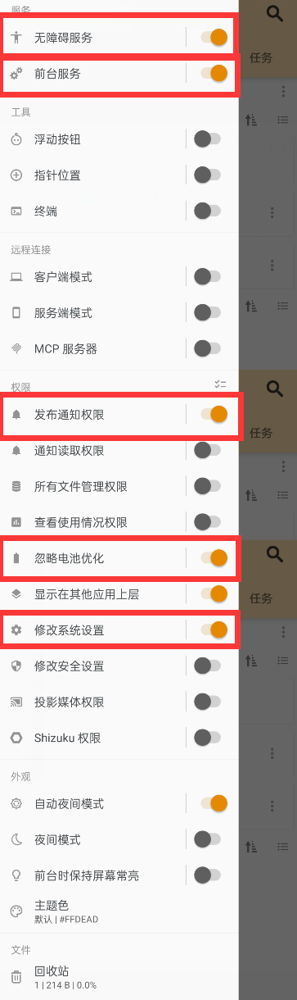

# AutoJS6抖音自动续火花
readme文档编写时间：2025年7月10日20点41分
#### 介绍
抖音自动续火花AutoJS6脚本源码_v3.0_by_myqf/ewaaa

**有任何问题欢迎来作者bilibili留言，随时关注：[LuckyLK-的个人空间-LuckyLK-个人主页-哔哩哔哩视频](https://space.bilibili.com/515953193?spm_id_from=333.1007.0.0)**

**使用方法手把手视频教程**：[自研抖音续火花脚本手把手安装教程来啦！](https://www.bilibili.com/video/BV1QMGpzbEKV/?spm_id_from=333.1387.homepage.video_card.click&vd_source=f02d2b99108a7c1dbc000e0758bc5275)

#### 软件架构：
AutoJS6

JavaScript

#### 使用说明：

1.  安装AutoJS6  https://link.juejin.cn/?target=https%3A%2F%2Fgithub.com%2FSuperMonster003%2FAutoJs6%2Freleases
2.  设置autojs权限，下图圈出了该脚本所需的权限

3.  克隆脚本到你的autojs下
4.  填写需要填写的内容，例如好友昵称，锁屏密码
5.  运行脚本

#### 注意事项：

1.  请勿同时运行多个重复脚本
2.  脚本运行过程中请勿进行任何操作
3.  作者**测试使用版本**： https://link.juejin.cn/?target=https%3A%2F%2Fgithub.com%2FSuperMonster003%2FAutoJs6%2Freleases%2Fdownload%2Fv6.5.0%2Fautojs6-v6.5.0-arm64-v8a-7a07b863.apk 最新autojs版本（6.6.4）经测试也可以
4.  若新版本的脚本使用有问题，例如通过按钮名称自动寻找按钮位置点击无法生效，尝试使用老版本的通过指定手机坐标的方式点击对应坐标按钮

#### 常见问题回答：

1. autojs如何下载安装使用？

这个你可以去查相关教程，都特别详细，简直是保姆级教程。

2. 这个脚本可以给多个人发送消息吗？

可以的，在昵称列表里填写多个好友昵称，脚本会依次遍历，上一个发送完毕后会退回消息界面给下一个人发送消息

3. 脚本发送的内容可以自定义吗？

可以的，我还没有把脚本输入内容放到最上面让用户填写，因为我现在用的是通过http请求一个接口，来获取不同的名人名言内容，如果你想修改，可以往下翻翻，有settext()方法，可以修改发送的内容。

4. 如何知道我手机点击位置的坐标？

一种方法是通过开发者模式，打开显示坐标功能，具体步骤可以自己查询。第二种方法是通过autojs手机端的悬浮窗获得坐标，详细可见这个网址：(https://blog.itvv.cn/archives/483)。第三种方法是通过测量手机长宽，并通过与手机分辨率的比例，通过解方程计算出大致位置坐标。

#### 参与贡献
开发环境：
1.  AutoJS6  
2.  Microsoft VS Code

开发成员：
1.  明月清风/myqf/ewaaa
